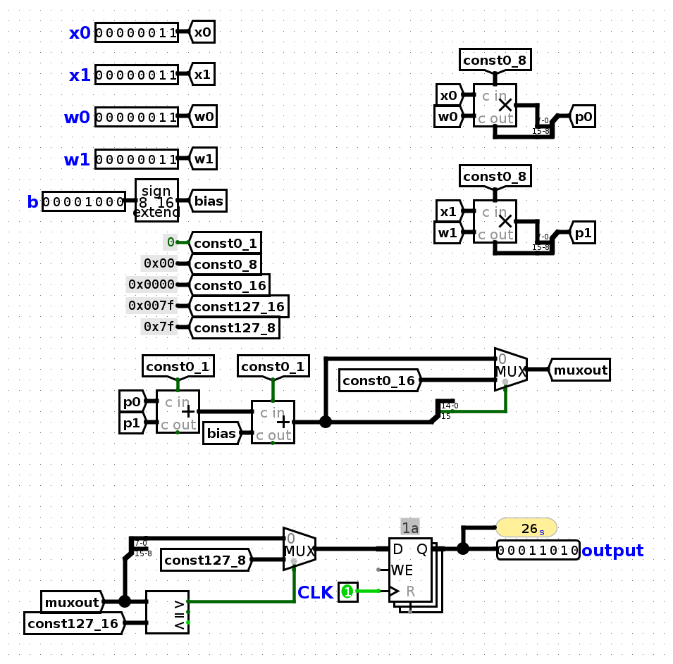
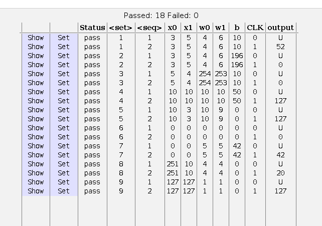
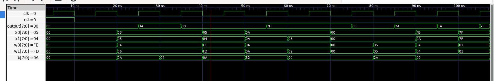
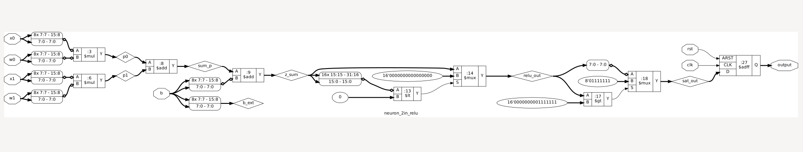

# Hardware Perceptron: Can Hardware Beat Software at the Neuron Level?

A personal exploration designing, verifying, and synthesizing an atomic 8-bit signed ReLU perceptron in raw digital logic, and benchmarking hardware latency against compiled C and Python.

**Toolchain:** Logisim-Evolution, GHDL, Yosys, GTKWave, GCC, Python 3.

---

## 1. Motivation & Premise

Most modern machine learning optimization focuses on the software stack: quantization schemes, custom CUDA kernels, graph compilers, and runtime runtimes—all battling CPU/GPU memory hierarchies and instruction overhead.

I wanted to step back and ask a fundamental question: **what happens if I strip away the OS, instruction decoding, and memory busses entirely and implement the neuron directly in silicon?**

To find out, I built this proof-of-concept:
1. Implemented an atomic computational unit—a 2-input signed 8-bit ReLU perceptron—in digital logic.
2. Verified the design using Logisim-Evolution and VHDL-2008 testbenches.
3. Synthesized it down to elementary logic gates using Yosys.
4. Benchmarked its physical latency against optimized C (`gcc -O2`) and Python 3.

---

## 2. Circuit Architecture & Math

### 2.1 The Neuron Function
The circuit evaluates:

$$\text{Output} = \text{Clamp}\Big(\text{ReLU}\big((x_0 \cdot w_0) + (x_1 \cdot w_1) + b\big)\Big)$$



### 2.2 Hardware Design Choices

* **Signed 2's Complement:** Full support for negative weights (inhibitory synapses) and negative biases (firing thresholds).
* **Natural Bit Growth ($8 \times 8 \rightarrow 16$):** Rather than sign-extending 8-bit inputs to 16 bits before multiplication (which would quadruple multiplier area), I multiply them directly as 8-bit values. The multiplier naturally yields a 16-bit product, saving ~75% of multiplier gate area.
* **Zero-Comparator ReLU:** Instead of spending gates on an arithmetic comparator ($Z < 0$), I route the sign bit (bit 15) straight to the select line of a 16-bit 2:1 MUX. If bit 15 is `1` (negative), the MUX selects `0x0000`; otherwise, it passes $Z$. Zero extra comparator gates required.
* **Saturation Clamping $[0, 127]$:** To allow neurons to cascade into multi-layer networks without word-length explosion, an overflow comparator checks if $Z > 127$ (`0x007F`). If true, the output clamps to $+127$ (`0x7F`); otherwise, it passes the low byte. The output is always a valid signed 8-bit value $[0, 127]$.
* **Registered Output:** An 8-bit D-Flip-Flop register samples on the rising clock edge, filtering out combinational switching glitches before downstream consumption.

---

## 3. Verification & Synthesis Walkthrough

### 3.1 Logisim-Evolution (Visual Prototyping)
I first modeled the schematic in Logisim-Evolution and tested it against an automated 18-step sequential vector suite (`sim/test_vector.txt`). This verified corner cases: positive sums, negative clamping, inhibitory weights, saturation limits, and boundary zero states.



### 3.2 VHDL Simulation (GHDL + GTKWave)
Next, I wrote a synthesizable VHDL-2008 implementation (`hdl/neuron_2in_relu.vhd`) and a self-checking testbench (`sim/tb_neuron.vhd`). 

The GTKWave trace confirms deterministic single-clock-cycle execution:



### 3.3 Gate-Level Synthesis (Yosys)
I synthesized the VHDL core to raw gate primitives using Yosys and the GHDL plugin:



* **Cell Count:** 962 elementary gates (426 NAND, 271 XOR, 143 AND, 55 XNOR, 22 OR, 8 MUX).
* **Flip-Flops:** 7 D-Flip-Flops. Yosys recognized that bit 7 of the output is always `0` due to the $[0, 127]$ saturation clamp, automatically optimizing away the unused register bit.
* **DRC:** 0 errors.

---

## 4. Benchmarks: Hardware vs. C vs. Python

To prevent `gcc` from optimizing loop calculations into constants at compile time, the software benchmarks stream dynamic inputs and weights from memory arrays.

| Implementation / Platform | Latency / Inf | Clock Cycles | Throughput | Relative Speed |
|---|---|---|---|---|
| **Python 3** (Dynamic loop) | **~100.0 ns** | ~400 CPU cycles | 10.0 M inf/sec | **$1.0\times$ (Baseline)** |
| **C (`gcc -O2`)** (Dynamic loop) | **~1.5 ns** | ~6 CPU cycles | 665.1 M inf/sec | **$66.7\times$ faster** |
| **Hardware Core** (FPGA @ 100 MHz) | **10.0 ns** | **1 Cycle** | 100.0 M inf/sec | **$10.0\times$ faster** |
| **Hardware Core** (ASIC @ 500 MHz) | **2.0 ns** | **1 Cycle** | 500.0 M inf/sec | **$50.0\times$ faster** |
| **Hardware Core** (Pure Combinational) | **~0.5 ns** | **0 Cycles (Wire delay)** | Continuous | **$200.0\times$ faster** |

### 4.1 The Scaling Inflection Point ($\mathcal{O}(N)$ vs $\mathcal{O}(1)$)

For a single standalone neuron, compiled C on an x86 core at 4.0 GHz clocks in at ~1.5 ns—faster than a 100 MHz FPGA. However, the architectural reality changes dramatically as network size scales:

1. **Serial CPU Execution is $\mathcal{O}(N)$:** A CPU core evaluates neurons sequentially. Evaluating 1,000 neurons takes **$1.5\ \mu\text{s}$**, and 1,000,000 neurons take **$1.5\text{ ms}$**.
2. **Spatial Hardware Execution is $\mathcal{O}(1)$:** Dedicated silicon instantiates physical multipliers and adders for every neuron. All 1,000 neurons compute simultaneously in the exact same **$10\text{ ns}$**.
3. **Energy Efficiency:** An x86 instruction pipeline spends ~10–50 pJ per MAC just fetching opcodes, decoding instructions, and managing cache tags. Dedicated spatial logic evaluates the same MAC at **$< 0.1\text{ pJ}$**.

---

## 5. Reproduction Steps (POC Quickstart)

I set up this repository so anyone (and future me) can reproduce the entire pipeline from scratch.

### 5.1 Prerequisites
Install the required open-source EDA and compilation tools:

```bash
# Ubuntu / Debian
sudo apt-get install ghdl yosys gtkwave gcc python3
```

*(Optional: Download [Logisim-Evolution](https://github.com/logisim-evolution/logisim-evolution) if you want to inspect or modify the visual `.circ` schematic).*

### 5.2 Verification & Benchmarking Runbook

```bash
# 1. Run VHDL simulation and check self-verifying testbench assertions
make sim

# 2. View simulation waveforms in GTKWave
make wave

# 3. Synthesize to gate-level netlist with Yosys and inspect cell statistics
make synth

# 4. Compile and run C and Python software latency benchmarks
make bench

# 5. Clean intermediate simulation and compilation artifacts
make clean
```

---

## 6. Project Structure

```
.
├── .gitignore                   # Ignore simulator, compiler, and OS binaries
├── Makefile                     # Build automation (sim, wave, synth, bench)
├── README.md
├── assets/                      # Diagrams and synthesis screenshots
│   ├── gtkwave_simulation.png
│   ├── logisim_schematic.png
│   ├── logisim_test_vector.png
│   └── yosys_synthesis.png
├── benchmarks/
│   ├── benchmark.c              # Dynamic C latency benchmark (gcc -O2)
│   └── benchmark.py             # Python 3 latency benchmark
├── hdl/
│   └── neuron_2in_relu.vhd      # Synthesizable VHDL-2008 perceptron core
├── logisim/
│   └── perceptron_2in_relu.circ # Visual schematic and test vector harness
└── sim/
    ├── tb_neuron.vhd            # Self-checking VHDL testbench
    ├── test_vector.txt          # Sequential test vectors (18 steps)
    └── waveform.vcd             # Value Change Dump waveform output
```

---

## 7. Next Experiments

Things I plan to explore next on top of this core:

- **Parameterize Inputs ($N$ Inputs):** Make input width generic ($N = 4, 8, 16$) to study adder-tree fan-in and critical path delay.
- **Physical FPGA Deployment:** Place & route for Lattice iCE40 or ECP5 using `nextpnr` and measure real pin-to-pin latency and power on an oscilloscope.
- **2-Layer MLP (XOR Solver):** Wire four hardware perceptrons together (2 input, 2 hidden, 1 output) to solve the non-linear XOR problem entirely in logic.
- **Weight-Stationary Systolic Array:** Tile units into a 2D grid for hardware matrix multiplication (GEMM).
- **OpenLane ASIC Tapeout:** Harden the layout with the SkyWater 130nm PDK for a Tiny Tapeout run.
